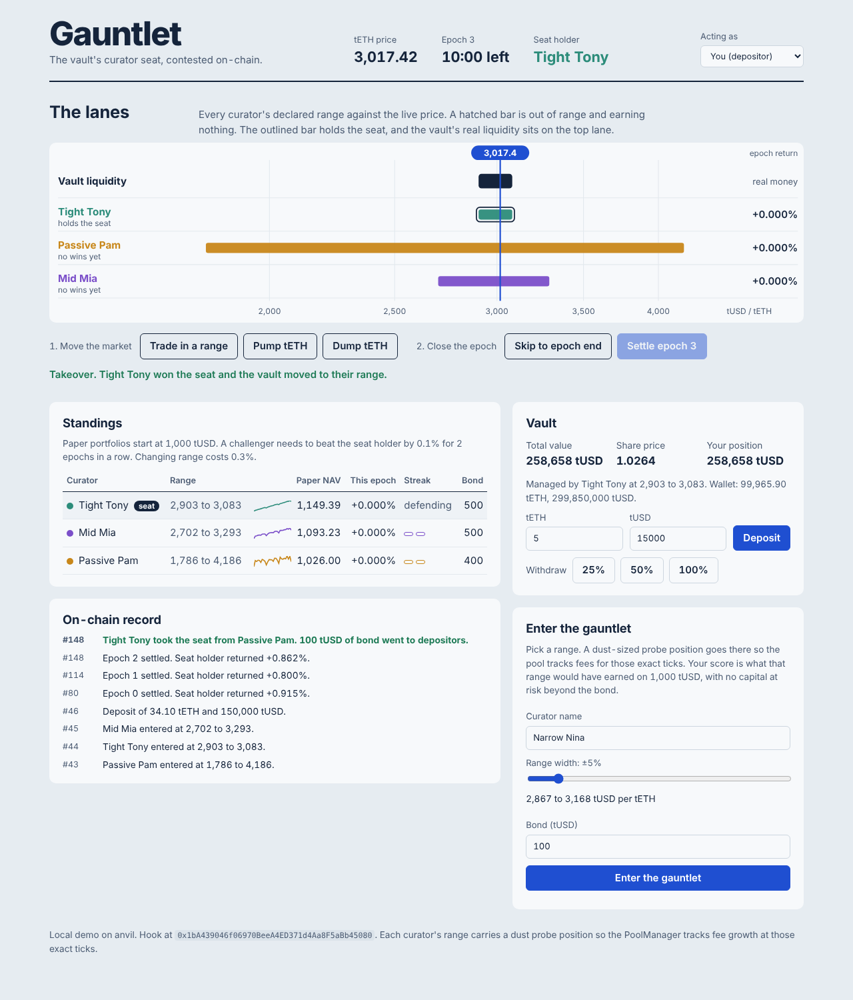
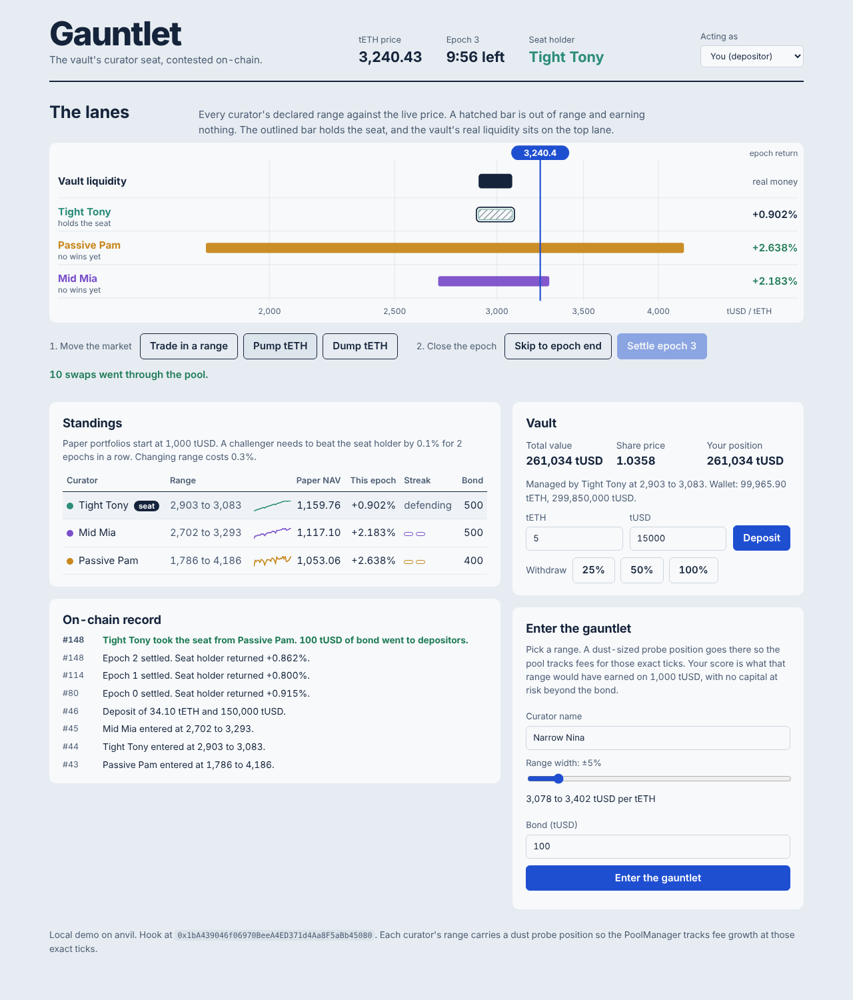

# Gauntlet

**A Uniswap v4 hook where the right to manage a vault's liquidity is contested on-chain.**

Anyone can challenge the vault's curator. Challengers don't need capital to prove themselves: the hook drops a dust-sized "probe" position at their declared range. That makes the PoolManager track fee growth at those exact ticks, so the hook can compute what the range *would have* earned with real swap data. A challenger who beats the seat holder for enough epochs in a row takes over, and the vault's real liquidity moves to their range automatically.

Built for the UHI11 Hookathon theme, **Active Management & Curation**. It hits three of the four listed directions in one system: curated LP networks, backtesting (forward-testing, really), and strategy migration.



---

## The problem

Curated LP vaults ask depositors to trust a manager. Today you pick one based on their marketing, or a backtest they ran themselves on data they chose. Nothing on-chain says "this manager is actually better than the alternatives right now", and nothing replaces a bad manager without governance drama.

## The idea

Make the curator seat a competition that settles itself:

1. **The seat holder** runs the vault. Their range is where depositors' liquidity actually sits.
2. **Challengers** post a bond and declare a range. They get a **paper portfolio** of 1,000 tUSD notional at that range.
3. **The probe trick.** v4 only tracks `feeGrowthInside` for ticks that have liquidity. So the hook adds `1e9` units of dust liquidity at every declared range. Now `StateLibrary.getFeeGrowthInside` returns real fee growth for that range, and the hook can credit each paper portfolio exactly what that range earned per unit of liquidity, plus the real price exposure of holding it. No oracle, no off-chain backtest, no trust.
4. **Epochs.** At each epoch end anyone can call `settleEpoch()`. Every paper portfolio is marked to market. A challenger whose epoch return beats the seat holder's by `marginBps` gets a win. `winStreak` wins in a row and they take the seat.
5. **Migration.** On takeover, the hook pulls the vault's liquidity and redeploys it at the winner's range in the same transaction. The old seat holder loses `slashBps` of their bond, which goes straight to depositors.

The seat holder is scored the same way as everyone else (its own paper portfolio), so the race is apples to apples.

## Why it's hard to game

| Attack | Defense |
|---|---|
| Flash-swap the price to inflate your paper NAV right before settling | All accounting uses the **block-open price**, snapshotted in `beforeSwap` on the first swap of each block. An in-block price push doesn't move it. |
| Sandwich your own vault while rebalancing, or deposit/withdraw at a pushed price | Vault-moving actions revert if spot is more than `maxTickDeviation` ticks from the block-open price. |
| Declare a range after you've seen where the price went | Ranges only accrue from the moment they're declared. There's no way to backdate one. |
| Flip ranges every block to chase fees | Every range change charges `switchCostBps` on the paper portfolio, a proxy for real swap costs. |
| Join late in an epoch with a lucky streak | A challenger must be present for the **whole** epoch to be eligible. |
| Spam the leaderboard | Bond required, max 8 curators. |
| Carry wins earned against the old seat holder into the new reign | All streaks reset on takeover. |

Known limitation, said out loud: a curator could wash-trade to inflate fee growth at their range. It costs them the swap fees, which go to *real* liquidity in that range, and any range overlapping theirs benefits too. A production version would cap per-epoch fee credit or weight fees by unique swappers.

## What the demo shows

Hit **Trade in a range** a few times and the tight curator out-earns the wide one on fees. Settle three epochs and you'll watch the seat change hands and the vault bar slide to the new range. Then hit **Pump tETH**: the price walks out of the tight range, it goes hatched (earning nothing), and the wide-range curator leads the next epoch. The market regime decides who should manage, and the hook figures it out by itself.



---

## Run it

Needs [Foundry](https://book.getfoundry.sh/getting-started/installation) and Node 18+.

```bash
./demo.sh
```

Then open http://localhost:5173. That one command:

1. starts a local anvil chain
2. deploys a PoolManager, tETH/tUSD test tokens, swap and LP routers, and the hook at a flag-mined CREATE2 address
3. creates a tETH/tUSD pool at about 3,000 with deep background liquidity
4. seeds three curators (Passive Pam ±40% holds the seat, Tight Tony ±3%, Mid Mia ±10%) and a vault deposit
5. starts the frontend

**On Windows:** run `./demo.sh` from WSL (Ubuntu) with Foundry and Node installed there. Or split it: run `anvil --host 0.0.0.0` and the deploy steps from `demo.sh` inside WSL, then start the frontend from Windows with `cd frontend && npm install && npx vite`. WSL forwards `127.0.0.1:8545` to Windows, so the frontend reaches anvil. The frontend reads the RPC URL from `VITE_RPC_URL` (default `http://127.0.0.1:8545`).

The frontend signs with anvil's dev keys, so there's no wallet popup. Use **Acting as** to switch between the depositor, fresh challenger wallets and the seeded curators.

### Tests

```bash
cd contracts
forge test
```

18 tests, covering:
- the probe measuring fees
- a takeover after the streak
- slashing going to depositors
- a trending market favouring the wide range
- in-block manipulation being ignored
- deposit/withdraw round trips
- all the access-control reverts

### Testnet

```bash
cd contracts
PRIVATE_KEY=0x... \
POOL_MANAGER=0x00b036b58a818b1bc34d502d3fe730db729e62ac \
forge script script/DeployTestnet.s.sol --rpc-url https://sepolia.unichain.org --broadcast
```

That's the Unichain Sepolia PoolManager. Sepolia, Base Sepolia and Arbitrum Sepolia addresses are in the script header. It deploys test tokens, the hook, routers, a pool with liquidity and a "Genesis" seat holder, and writes `deployments/<chainId>.json`.

---

## Architecture

```
contracts/
  src/GauntletHook.sol     the hook, the vault (ERC20 shares) and the curator registry, in one contract
  test/GauntletHook.t.sol  18 Foundry tests
  script/DeployLocal.s.sol local world with seeded curators
  script/DeployTestnet.s.sol deploy against a real v4 PoolManager
frontend/                  Vite + React + viem dashboard
scripts/export_abi.py      copies ABIs into the frontend
demo.sh                    one-command demo
```

**Hook permissions:** `afterInitialize` (bind to one pool) and `beforeSwap` (snapshot the block-open price). That's it: the hook never touches swap pricing, so traders pay normal v4 fees and the pool stays a normal pool.

**Position layout inside the PoolManager**, all owned by the hook and separated by salt:

| salt | what |
|---|---|
| `bytes32(id)` | curator `id`'s probe, `1e9` liquidity at their declared range |
| `type(uint256).max` | the vault's real liquidity at the seat holder's range |

**Paper NAV math (per curator):**

```
fees     = (feeGrowthInside_now - feeGrowthInside_last) * vL / 2^128
position = amounts(vL, range, blockOpenPrice)
NAV      = value(position + fees + cash, blockOpenPrice)    // in tUSD
```

`vL` (virtual liquidity) is set so the portfolio is worth exactly its NAV when the range is declared. A range change re-derives `vL` from the current NAV minus the switch cost.

**Key functions:**

| function | who | what |
|---|---|---|
| `register(name, lower, upper, bond)` | anyone | enter. The first registrant takes the seat. |
| `declareRange(id, lower, upper)` | curator | move your range. The seat holder's move also moves the vault. |
| `settleEpoch()` | anyone | score, update streaks, hand over the seat if earned |
| `deposit / withdraw` | depositors | ERC20 vault shares priced at the block-open price |
| `exit(id)` | challenger | leave and reclaim your bond |
| `compound()` | anyone | reinvest the vault's collected fees |

## Mapped to the judging criteria

| Criterion | Weight | Where Gauntlet scores |
|---|---|---|
| Original idea | 30% | Using dust probe positions to make v4 track fees at hypothetical ranges is, as far as we found, new. No hook in the UHI directory does on-chain forward-testing of LP strategies or contested curation. |
| Unique execution | 25% | Pure v4 primitives (`getFeeGrowthInside`, salted positions, the unlock callback). No oracle, no keeper, no off-chain service. Manipulation-resistant block-open pricing. |
| Impact | 20% | Turns "trust the manager" into "the manager is whoever is actually winning". Depositors get automatic manager replacement plus slashed bonds. Strategists get a permissionless way to prove skill without capital. |
| Functionality | 15% | 18 passing tests, one-command demo, a full lifecycle with real swaps on a real PoolManager. |
| Presentation | 10% | Live dashboard: lanes view, standings with sparklines, on-chain event log. |

## Pitch video script (about 3 minutes)

1. **(0:00) The problem.** "LP vaults ask you to trust a manager. What if the manager had to keep earning the job?"
2. **(0:20) The trick.** Show the lanes. "Every challenger's range has a dust probe, so Uniswap itself tracks what that range earns. These numbers are real fee growth, not a backtest."
3. **(0:50) Ranging market.** Click *Trade in a range* twice. Point at Tony's paper NAV climbing faster than Pam's.
4. **(1:20) Takeover.** *Skip to epoch end* and *Settle*, three times. Call out the qualifying epoch, the streak pips filling, then the takeover message and the vault bar jumping to Tony's range. Show the slashed bond in the event log.
5. **(2:00) Regime change.** Click *Pump tETH*. Tony's bar goes hatched and Pam leads. "The hook will hand the seat back if this keeps up. Nobody had to vote."
6. **(2:30) Safety.** Flash the attack/defense table. Mention block-open pricing and the 18 tests.
7. **(2:50) Close.** "Gauntlet: curation as a competition that settles itself on-chain."

## Next steps

- Wallet-connected frontend for testnets (the demo uses anvil dev keys)
- Per-epoch fee-credit caps against wash trading
- Benchmark-relative performance fees: the seat holder earns a cut only on returns above a passive full-range benchmark (that's the probe trick again)
- Several vaults per pool with different risk mandates, all reading the same leaderboard
- Swap-based rebalancing on migration instead of leaving the unmatched side idle
